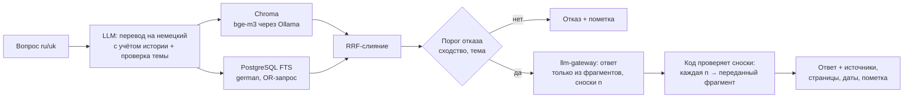

# amt-assistant

Публичный RAG-ассистент: отвечает **на русском и украинском** по официальным
немецким документам о **пособии по безработице (Arbeitslosengeld)** и **оплате
профессионального обучения (Bildungsgutschein, Förderung der beruflichen
Weiterbildung)**. В каждом ответе есть ссылка на документ, страницу и дату редакции.

> Это справка по документам, а не юридическая консультация. Пометка стоит на
> сайте и добавляется кодом к каждому ответу.

**Проблема.** Merkblätter и Fachliche Weisungen Bundesagentur für Arbeit написаны
сложным канцелярским немецким. Приезжим трудно найти в них ответ на простой
вопрос «получу ли я пособие, если уволюсь сам?».

## Как это работает



**Ingest** — фоновая задача BullMQ в отдельном процессе `worker`:
скачать PDF → SHA-256 (если файл не изменился, задача пропускается) → текст по
страницам (`pdf-parse`) → чанкинг по разделам (§, нумерованные заголовки,
Anlagen; раздел переходит через страницу, фрагмент — никогда) → удаление
колонтитулов → эмбеддинги `bge-m3` → Chroma + PostgreSQL (`tsvector german`).
Один `jobId` на документ: повторная постановка в очередь, пока задача ждёт или
выполняется, игнорируется.

**Ответ** — SSE-стрим `meta → sources → token… → done`. В `done` сервер отдаёт
проверенный текст: сноски на несуществующие фрагменты удалены; если не осталось
ни одной верной сноски или модель ответила `NO_ANSWER`, ответ заменяется отказом.

| Компонент | Что делает |
|---|---|
| `apps/api` | NestJS 11: auth (admin/user, гостевые сессии), чат, `/api/search`, админка, BullMQ-producer |
| `apps/api` → `dist/worker.js` | тот же код, процесс-потребитель очереди ingest |
| `apps/web` | Next.js 15: чат со стримингом и панелью источников, история, оценки, «Источники», админ-страница |
| `data/sources.yaml` | 20 официальных документов: адрес, редакция, дата проверки |
| `data/eval/questions.yaml` | 20 контрольных вопросов + 6 вопросов вне корпуса |
| `integrations/rag-probe` | HTTP-адаптер для стенда rag-probe |
| `infra/Caddyfile` | HTTPS (Let's Encrypt или локальный сертификат), SSE без буферизации |

## Демо локально (Mac)

Нужны Docker Desktop, Node 22 и Ollama.

```bash
ollama pull bge-m3
```

```bash
ollama pull qwen3.5:9b
```

### Вариант A — всё в Docker, как на сервере

```bash
cp .env.example .env
```

Поменяйте в `.env` пароли и `JWT_SECRET`, затем:

```bash
docker compose up -d --build
```

Откройте https://localhost (Caddy выпустит локальный сертификат — браузер
попросит подтвердить исключение). Админка: https://localhost/admin, вход —
`ADMIN_EMAIL` / `ADMIN_PASSWORD` из `.env`. Нажмите «Загрузить все из
sources.yaml» — worker скачает и проиндексирует 20 документов (несколько минут,
зависит от скорости эмбеддингов).

### Вариант B — хранилища в Docker, код через npm (удобно для разработки)

```bash
npm install
```

```bash
npm run infra:up
```

```bash
cp apps/api/.env.example apps/api/.env
```

В трёх терминалах:

```bash
npm run dev:api
```

```bash
npm run dev:worker
```

```bash
npm run dev:web
```

Сайт — http://localhost:3000, API — http://localhost:3001/api/health.
Хранилища слушают сдвинутые порты 55432 / 56379 / 58000, чтобы не мешать
другим проектам (переопределяются `DEV_PG_PORT`, `DEV_REDIS_PORT`, `DEV_CHROMA_PORT`).

> **«Думающие» модели.** У `qwen3.x` по умолчанию включены размышления: перевод
> вопроса занимает ~200 с вместо 1–4 с. `LLM_REASONING_EFFORT=none` (уже в
> `.env.example`) отключает их — значение уходит в запрос как `reasoning_effort`.

## Оценка

```bash
npm run eval -- --mode=search --k=3
```

```bash
npm run eval -- --mode=answer --out=../../reports/eval-answer.json
```

Критерий готовности: верный источник ≥ 16 из 20, все 6 вопросов вне корпуса
получают отказ. Скрипт завершается с кодом 1, если критерий не выполнен.
Порог отказа подбирается переменной `MIN_VECTOR_SIMILARITY` (по умолчанию 0.45).

## API

| Метод | Путь | Доступ |
|---|---|---|
| POST | `/api/auth/guest`, `/api/auth/register`, `/api/auth/login` | все |
| GET | `/api/auth/me` | user |
| POST | `/api/chat` (SSE) | user |
| GET/DELETE | `/api/conversations[/:id]` | владелец |
| POST | `/api/messages/:id/rating` `{score: 1 \| -1}` | владелец |
| POST | `/api/search` — поиск без генерации, [контракт](docs/search-api.md) | все или `x-api-key` |
| GET | `/api/documents`, `/api/health` | все |
| GET | `/api/admin/documents`, `/api/admin/stats` | admin |
| POST | `/api/admin/documents/sync`, `/api/admin/documents/:id/ingest` `{force}` | admin |

## Развёртывание на сервере

1. Сервер с Docker, A-запись домена указывает на него, открыты порты 80 и 443.
2. `git clone` в `/opt/amt-assistant`, `cp .env.example .env`, задать `DOMAIN`,
   `ACME_EMAIL`, пароли, `LLM_BASE_URL`/`LLM_API_KEY`/`LLM_MODEL` вашего llm-gateway.
3. Ollama для эмбеддингов: либо на хосте (`OLLAMA_URL=http://host.docker.internal:11434`),
   либо в compose — `docker compose --profile ollama up -d` и `OLLAMA_URL=http://ollama:11434`,
   затем `docker compose exec ollama ollama pull bge-m3`.
4. `docker compose up -d --build` — Caddy сам получит сертификат Let's Encrypt.
5. В GitHub: секреты `DEPLOY_HOST`, `DEPLOY_USER`, `DEPLOY_SSH_KEY`, `DEPLOY_KNOWN_HOSTS`,
   переменные `DEPLOY_PATH`, `DOMAIN`; деплой — ручной запуск workflow **Deploy**.

## Обновление корпуса

Ведомство меняет имена файлов (`…_baNNNNNN.pdf`) с каждой редакцией. Если ingest
падает с 404, найдите новую ссылку на странице из поля `page`, обновите `url` и
`date` в `data/sources.yaml` и нажмите «Переиндексировать» в админке. Документы,
которые убрали из YAML, админка показывает отдельно.

## Ограничения первой версии

- Одна тема; OCR нет — сканы без текстового слоя ingest отклоняет.
- llm-gateway предполагается OpenAI-совместимым (`/chat/completions`). Для другого
  протокола достаточно заменить `apps/api/src/rag/llm.service.ts`.
- Ожидаемые документы в контрольных вопросах составлены по содержанию корпуса;
  после первого прогона их стоит сверить вручную.
- Ответы — пересказ документов на дату их редакции, а не правовая оценка случая.
