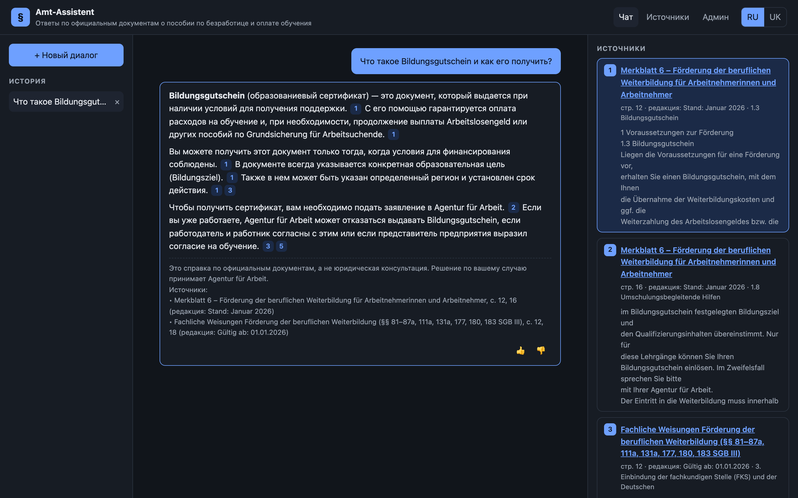
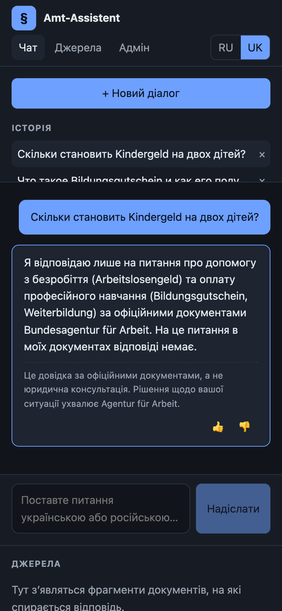
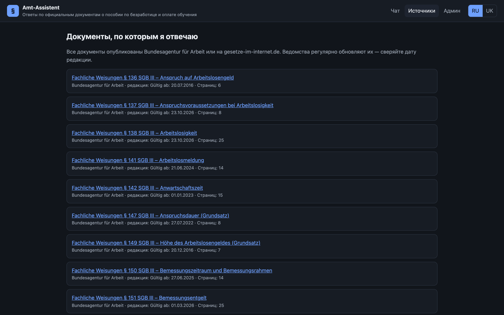
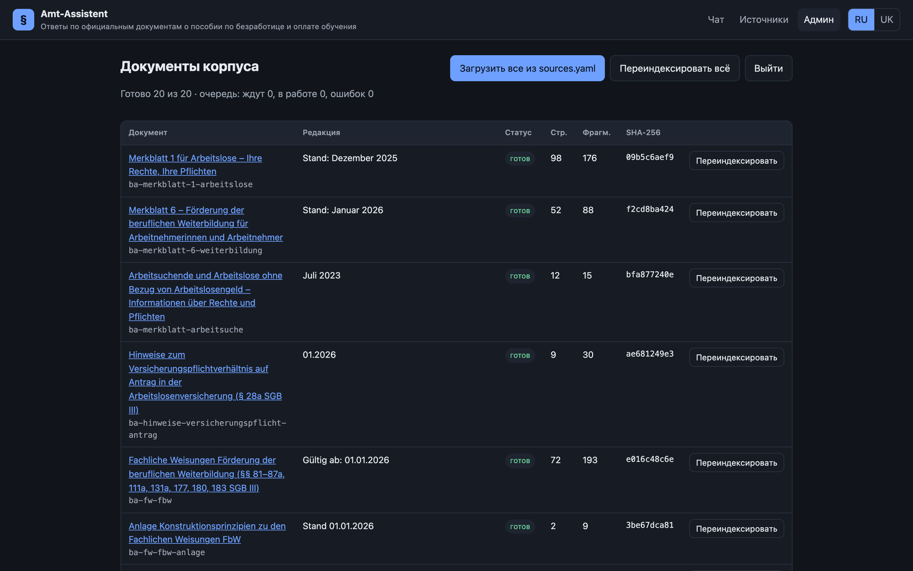
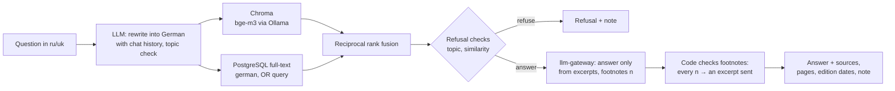

# amt-assistant

Answers questions in **Russian and Ukrainian** about German **unemployment benefit
(Arbeitslosengeld)** and **funded vocational training (Bildungsgutschein)**, using only
official documents of the Bundesagentur für Arbeit. Every answer cites the document,
the PDF page and the edition date; questions the documents do not cover are refused.

> This is reference information from official documents, not legal advice. The site
> says so on every page, and the code adds the same note to every answer.

## The problem

The rules for unemployment benefit are published by the Bundesagentur für Arbeit in
German: leaflets (Merkblätter) of up to 100 pages and internal instructions (Fachliche
Weisungen) written in legal language. People who moved to Germany recently, many of
them from Ukraine, often cannot find in these documents the answer to a simple question
such as "Will I get benefit if I quit my job myself?" or "Who pays for a retraining
course?". Machine translation of the whole PDF does not tell them which page applies.

## Who it is for

- Russian- and Ukrainian-speaking people in Germany who are unemployed, about to be,
  or looking for a funded course.
- Volunteers and counsellors who help them and need to find the right page in the
  official documents quickly.

It does not decide individual cases. It points to the passages of the official
documents that deal with the question, so the reader can check them or take them to the
Agentur für Arbeit.



*An answer from the local `qwen3.5:9b` model. The footnotes point at the right pages
of Merkblatt 6; the Russian wording has errors (for example the invented word
`образованиевый`). See [Known limitations](#known-limitations).*

| Out-of-scope question in Ukrainian, phone width | Corpus page and admin page |
|---|---|
|  | <br> |

## Features

- Questions in Russian or Ukrainian, answers in the same language
- Corpus of 20 official documents (Bundesagentur für Arbeit leaflets and instructions, AZAV), listed with URL and edition date in one YAML file
- Background ingest: PDF download, text per page, section-aware chunking, skip of unchanged files by SHA-256
- Query rewrite into German with the conversation history, so follow-up questions work
- Hybrid retrieval: vector search (Chroma, `bge-m3`) plus German full-text search (PostgreSQL), merged with reciprocal rank fusion
- Refusal of off-topic questions and of questions without a close enough match
- Answers only from the retrieved excerpts, with numbered footnotes checked by code
- Every footnote links to the exact PDF page; every answer ends with the sources, their edition dates and a "not legal advice" note
- Streaming answers (Server-Sent Events) with a sources panel
- Guest sessions, user and admin roles, conversation history, answer ratings
- Admin page: ingest status of every document, re-indexing, usage and negative ratings
- `/api/search` endpoint without generation, plus a Python adapter for the rag-probe test bench
- Docker Compose stack with HTTPS through Caddy, GitHub Actions CI

## Tech stack

| Layer | Technologies |
|---|---|
| Backend API | Node.js 22, TypeScript, NestJS 11, Zod (config and request validation), JWT auth, bcrypt, rate limiting (`@nestjs/throttler`) |
| RAG pipeline | LangChain JS: `ChatOpenAI` for any OpenAI-compatible LLM gateway, `OllamaEmbeddings`, `RecursiveCharacterTextSplitter`; `pdf-parse` for text per page |
| Models | Ollama; `bge-m3` (multilingual embeddings); `qwen3.5:9b` for the demo, a model behind llm-gateway in production |
| Search and storage | ChromaDB 1.5 (vectors, cosine), PostgreSQL 16 (German full-text search with `tsvector`, users, history, ratings) |
| Background jobs | Redis 7, BullMQ (ingest queue, separate worker process) |
| Frontend | Next.js 15 (App Router, standalone build), React 19, streaming chat over SSE |
| Infrastructure | Docker, Docker Compose, Caddy 2 (HTTPS with Let's Encrypt or a local CA) |
| Quality | Vitest offline tests, live checks against a real model, GitHub Actions CI, English and link checks |
| Integration | Python 3.10+ standard library adapter for rag-probe |

## What was checked, and how

| What | How | Result |
|---|---|---|
| Pipeline logic | 64 offline tests in [`apps/api/test/offline`](apps/api/test/offline): fakes for the model, Chroma, Postgres and storage; network access throws | All pass. To see that the tests can fail, the code was broken on purpose seven ways (ignore a retrieval refusal, accept an uncited answer, stream `NO_ANSWER`, drop the similarity threshold, keep vanished rows, read empty env values as set, skip unchanged files only when the status is `ready`); each break failed a test |
| Retrieval with a real model | Live check `npm run live:search`, 20 control questions + 6 out-of-corpus questions | 19/20 expected document in the top 3, 6/6 refused ([report](reports/live/search.md)) |
| Answers with a real model | Live check `npm run live:answer`: expected document among the footnotes of the generated answer | 19/20, 6/6 refused, median 25 s per answer ([report](reports/live/answer.md)) |
| Full Docker stack | `docker compose up` on macOS (Docker Desktop), Ollama on the host; live search through Caddy over HTTPS | 20 documents indexed in about 70 s; 19/20, 6/6 ([report](reports/live/docker/search.md)); the answer stream arrives in pieces through Caddy; re-ingesting an unchanged file is skipped |
| Web UI | Headless Chrome and a browser, desktop and 390 px width, production build | Chat, footnotes, sources panel, history, ratings, refusals, admin login and ingest status work |
| rag-probe adapter | Smoke test of [`amt_assistant_adapter.py`](integrations/rag-probe/amt_assistant_adapter.py) against the local API | Returns ranked excerpts; not yet run inside rag-probe itself |

All live checks used `bge-m3` embeddings and `qwen3.5:9b` for the query rewrite and the
answers, through a local Ollama on a Mac. The control questions and the expected
documents are in [`data/eval/questions.yaml`](data/eval/questions.yaml).

Not checked yet: deployment to a server with a real domain and Let's Encrypt, the
`ollama` Compose profile, the real llm-gateway, and the CI workflow on GitHub.

## How it works



**Refusals happen at three points.** The rewrite model marks off-topic questions
(Kindergeld, residence permits, taxes…); retrieval refuses when the best vector match is
below `MIN_VECTOR_SIMILARITY` (0.45); after generation, code replaces the answer with a
refusal if the model said `NO_ANSWER` or if no footnote points at an excerpt it was
given. Footnotes to excerpts that were not sent are removed.

**Ingest** runs as a BullMQ job in a separate `worker` process: download the PDF →
SHA-256 (an unchanged file is skipped) → text per page (`pdf-parse`) → chunking by
section (§, numbered headings, Anlagen; a section may span pages, a chunk never does)
→ running headers and footers removed → `bge-m3` embeddings → Chroma and PostgreSQL
(`tsvector german`). One job id per document, so a second request while a job is
waiting or running is ignored.

**Answers** are streamed as Server-Sent Events: `meta → sources → token… → done`. The
`done` event carries the checked text, which replaces the streamed one.

### Where a question goes

| Step | From → to | What happens |
|---|---|---|
| 1 | Browser → Caddy | HTTPS. Caddy sends `/api/*` to the API and everything else to the Next.js site |
| 2 | Browser → API `/api/auth/guest` | First visit: an anonymous guest account and a JWT, so history and ratings work |
| 3 | Browser → API `POST /api/chat` | The question opens a Server-Sent Events stream |
| 4 | API → LLM | Rewrite: the question and the last 6 turns become `{lang, in_scope, query_de}` |
| 5 | API → Ollama | `bge-m3` embedding of the German query |
| 6 | API → Chroma and PostgreSQL | In parallel: top 20 by cosine similarity and top 20 by German full-text search |
| 7 | API | Reciprocal rank fusion → 6 excerpts; refusal if off-topic, below the similarity threshold or the index is empty |
| 8 | API → LLM | The 6 numbered excerpts and the question; tokens stream back |
| 9 | API → browser | Events `meta` (language, German query), `sources` (excerpts), `token`… , `done` (checked text, cited sources, footer) |
| 10 | API → PostgreSQL | Question, answer, citations, footer and refusal reason are stored; a rating is stored later |

### How a document gets into the index

| Step | Component | What happens |
|---|---|---|
| 1 | Admin page → API | "Load all from sources.yaml" or "Re-index" for one document |
| 2 | API → Redis | One BullMQ job per document; a second request while it waits or runs is ignored |
| 3 | Worker → agency website | Download the PDF (only files that start with `%PDF-`, up to 60 MB) |
| 4 | Worker → PostgreSQL | SHA-256 compared with the last successful run; an unchanged file is skipped |
| 5 | Worker | Text per page, running headers and footers removed, chunks by section, never across a page |
| 6 | Worker → Ollama | `bge-m3` embedding of every chunk, with the document and section title for context |
| 7 | Worker → Chroma | Old vectors of the document replaced by the new ones |
| 8 | Worker → PostgreSQL | In one transaction: chunks with their `tsvector`, page count, hash, status `ready` |

### Where data lives

| Store | Contents |
|---|---|
| PostgreSQL | Users and roles, documents and ingest status, chunks with full-text index, conversations, messages with citations, ratings |
| Chroma | One vector per chunk, with the chunk id, document id and page |
| Redis | The ingest queue |
| [`data/sources.yaml`](data/sources.yaml) | The list of documents: the only place to add or update one |
| Ollama | The embedding model (and the LLM in the demo) |
| Caddy volume | TLS certificates |

### Components

| Part | Role |
|---|---|
| [`apps/api`](apps/api) | NestJS 11: auth (admin/user, guest sessions), chat, `/api/search`, admin, ingest queue producer |
| `apps/api` → `dist/worker.js` | Same code base, ingest queue consumer |
| [`apps/web`](apps/web) | Next.js 15: streaming chat, sources panel, history, ratings, sources page, admin page |
| [`data/sources.yaml`](data/sources.yaml) | The 20 documents: URL, edition, date the URL was checked |
| [`integrations/rag-probe`](integrations/rag-probe/README.md) | HTTP adapter for the rag-probe test bench |
| [`infra/Caddyfile`](infra/Caddyfile) | HTTPS (Let's Encrypt or a local CA), SSE without buffering |

## Project structure

```text
amt-assistant/
├── apps/
│   ├── api/                      NestJS API and ingest worker
│   │   ├── src/
│   │   │   ├── auth/             guest sessions, login, roles
│   │   │   ├── chat/             SSE chat, answer generation, history, ratings
│   │   │   ├── rag/              query rewrite, embeddings, Chroma, full-text search, fusion, citation checks, prompts
│   │   │   ├── ingest/           PDF text, chunker, BullMQ producer and worker
│   │   │   ├── search/           /api/search for external evaluation
│   │   │   ├── admin/            document status, re-index, stats
│   │   │   ├── db/               PostgreSQL pool and migrations
│   │   │   ├── live/             live checks against a running system
│   │   │   ├── main.ts           API entry point
│   │   │   └── worker.ts         worker entry point
│   │   └── test/offline/         offline tests with fakes
│   └── web/                      Next.js site: chat, sources page, admin page
├── data/
│   ├── sources.yaml              the 20 documents
│   └── eval/questions.yaml       control questions
├── docs/                         search API contract, screenshots
├── infra/Caddyfile               HTTPS reverse proxy
├── integrations/rag-probe/       Python adapter for the rag-probe test bench
├── reports/live/                 live check reports
├── scripts/                      English and link checks
├── docker-compose.yml            full stack
└── docker-compose.dev.yml        data stores for local development
```

## Run it locally

You need Docker, Node 22 and [Ollama](https://ollama.com) with two models:

```bash
ollama pull bge-m3
```

```bash
ollama pull qwen3.5:9b
```

### Option A: everything in Docker, as on a server

```bash
cp .env.example .env
```

Set `POSTGRES_PASSWORD`, `JWT_SECRET` and `ADMIN_PASSWORD` in `.env` (for example with
`openssl rand -hex 24`), then:

```bash
docker compose up -d --build
```

Open https://localhost. Caddy issues a certificate from its own local CA, so the browser
shows a warning. The admin page is https://localhost/admin (log in with `ADMIN_EMAIL` /
`ADMIN_PASSWORD`); press `Загрузить все из sources.yaml` to download and index the
20 documents.

### Option B: data stores in Docker, code with npm (for development)

```bash
npm install
```

```bash
npm run infra:up
```

```bash
cp apps/api/.env.example apps/api/.env
```

Then, in three terminals:

```bash
npm run dev:api
```

```bash
npm run dev:worker
```

```bash
npm run dev:web
```

The site is at http://localhost:3000, the API at http://localhost:3001/api/health. The
data stores listen on 127.0.0.1 with shifted ports 55432 / 56379 / 58000
(`DEV_PG_PORT`, `DEV_REDIS_PORT`, `DEV_CHROMA_PORT`).

> **Reasoning models.** `qwen3.x` reasons by default, and the query rewrite then takes
> about 200 s instead of 1–4 s. `LLM_REASONING_EFFORT=none` (already in
> `.env.example`) turns it off; it is sent to the model as `reasoning_effort`.

## Tests and live checks

These are two different things and are named so they cannot be confused.

| | Offline tests | Live checks |
|---|---|---|
| Command | `npm run test:offline` | `npm run live:search`, `npm run live:answer` |
| Code | [`apps/api/test/offline`](apps/api/test/offline) | [`apps/api/src/live/live-check.ts`](apps/api/src/live/live-check.ts) |
| Needs | Nothing; the network is blocked | A running API, a real model, an indexed corpus |
| Measures | Whether the code does what it should | How well the model and the corpus answer the control questions |
| In CI | Yes | No |
| Output | Test results | `reports/live/<mode>.md` and `.json` with commit, models and index size |

A live check exits with 0 if at least 16 of 20 questions get the expected document and
every out-of-corpus question is refused, with 1 if not, and with 2 if there is no running
system to check. Point it at another deployment with `--api=https://…`.

CI also runs `npm run check:english` (code and docs stay in English; Russian and
Ukrainian only in user-facing strings and test data) and `npm run check:links` (every
relative link and image in Markdown points at a tracked file).

## API

| Method | Path | Access |
|---|---|---|
| POST | `/api/auth/guest`, `/api/auth/register`, `/api/auth/login` | anyone |
| GET | `/api/auth/me` | user |
| POST | `/api/chat` (SSE) | user |
| GET/DELETE | `/api/conversations[/:id]` | owner |
| POST | `/api/messages/:id/rating` `{score: 1 \| -1}` | owner |
| POST | `/api/search`: retrieval without generation, [contract](docs/search-api.md) | anyone, or `x-api-key` if `SEARCH_API_KEY` is set |
| GET | `/api/documents`, `/api/health` | anyone |
| GET | `/api/admin/documents`, `/api/admin/stats` | admin |
| POST | `/api/admin/documents/sync`, `/api/admin/documents/:id/ingest` `{force}` | admin |

## Deploying to a server

Not done yet for this project; these are the intended steps.

1. A server with Docker, an A record for the domain pointing at it, ports 80 and 443 open.
2. Clone into `/opt/amt-assistant`, `cp .env.example .env`, set `DOMAIN`, the secrets
   and `LLM_BASE_URL` / `LLM_API_KEY` / `LLM_MODEL` of the llm-gateway.
3. Embeddings: Ollama on the host (`OLLAMA_URL=http://host.docker.internal:11434`) or in
   Compose (`docker compose --profile ollama up -d`, `OLLAMA_URL=http://ollama:11434`,
   then `docker compose exec ollama ollama pull bge-m3`).
4. `docker compose up -d --build`. Caddy gets a Let's Encrypt certificate for `DOMAIN`.
5. On GitHub: secrets `DEPLOY_HOST`, `DEPLOY_USER`, `DEPLOY_SSH_KEY`, `DEPLOY_KNOWN_HOSTS`
   and variables `DEPLOY_PATH`, `DOMAIN`; deploy by running the **Deploy** workflow.

## Updating the corpus

The agency renames its files (`…_baNNNNNN.pdf`) with every edition. If ingest fails with
404, find the new link on the page given in the document's `page` field, update `url`
and `date` in [`data/sources.yaml`](data/sources.yaml) and press `Переиндексировать` on
the admin page. Documents removed from the YAML are listed separately on the admin page.

## Known limitations

**Answer quality**

- Answers come from a 9-billion-parameter local model, and its Russian and Ukrainian
  are unreliable even when the sources are right. Seen in the runs above: the invented
  word `образованиевый сертификат` for Bildungsgutschein; Sperrzeit translated into
  Ukrainian as `спрощений період` ("simplified period"); and for "Will I get benefit if I
  quit myself?" the answer "No, you will not get benefit" (`Нет, вы не получите пособие`), while the documents say the
  benefit is suspended for a period (Sperrzeit) and reduces the entitlement. A stronger
  model behind llm-gateway is expected to help; this has not been measured.
- The code checks that every footnote points at an excerpt that was sent to the model.
  It does not check that the sentence says what the excerpt says.
- A footnote can point at a page that is only loosely related: in the Sperrzeit answer
  above, footnote 1 led to a passage that is mainly about the Gründungszuschuss.

**What the numbers mean**

- The 20 control questions and their expected documents were written by the author from
  the documents' content. No lawyer or Agentur für Arbeit staff member reviewed them.
- A pass means the expected document was among the sources. It does not mean the answer
  was correct.
- q20 (duties of job seekers who get no benefit) fails in every run: the answer cites
  Merkblatt 1 instead of the leaflet for job seekers without benefit.
- Results vary between runs because the model rewrites the question differently: the
  same setup gave 18/20 and 19/20 in two runs of the search check.
- On a Mac with the local model an answer takes about 25 s (median), 32 s at the 90th
  percentile.

**Not verified**

- llm-gateway is assumed to be OpenAI-compatible (`POST /chat/completions`) and has not
  been tried. Another protocol needs a new [`llm.service.ts`](apps/api/src/rag/llm.service.ts).
- No server deployment yet: Let's Encrypt, the `ollama` Compose profile and the Deploy
  workflow have not run. CI has not run on GitHub yet.
- The site through Caddy was checked with `curl`, not in a browser, because the browser
  used does not trust Caddy's local CA. The same UI was checked in a browser without Caddy.

**Corpus and text extraction**

- One topic, 20 documents. Questions about Bürgergeld, Kindergeld, residence permits or
  taxes are refused, not answered.
- Scanned PDFs without a text layer are rejected; there is no OCR.
- `pdf-parse` sometimes splits words (`Arbeits losengeld` in the sources panel). Such
  words are missed by the German full-text search, and vector search has to cover them.
- Page numbers are pages of the PDF file, not the numbers printed on the page.
- File URLs change with every edition, and nothing checks for new editions; this is
  manual.

**Product**

- Answers in Russian and Ukrainian only. A question in German finds the right documents,
  but its language is detected as Russian and the answer is in Russian.
- The admin page is in Russian only.
- Earlier turns of a conversation are used to rewrite the question, not passed to the
  answer model.
- Every visitor gets a guest account in Postgres; old guest accounts are never deleted.
- Rate limits are kept in memory per API process and reset on restart.
- `/api/health` is public and shows the model names and the index size.

## License

[MIT](LICENSE)
